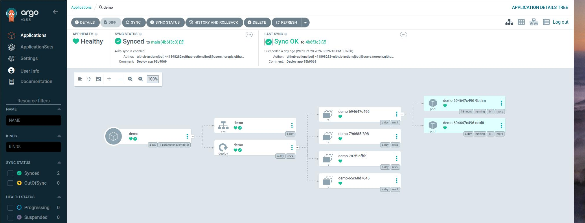
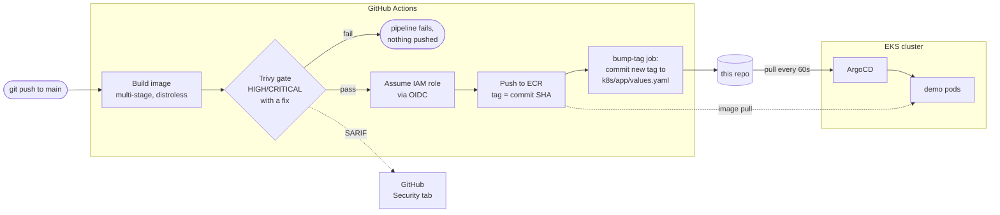
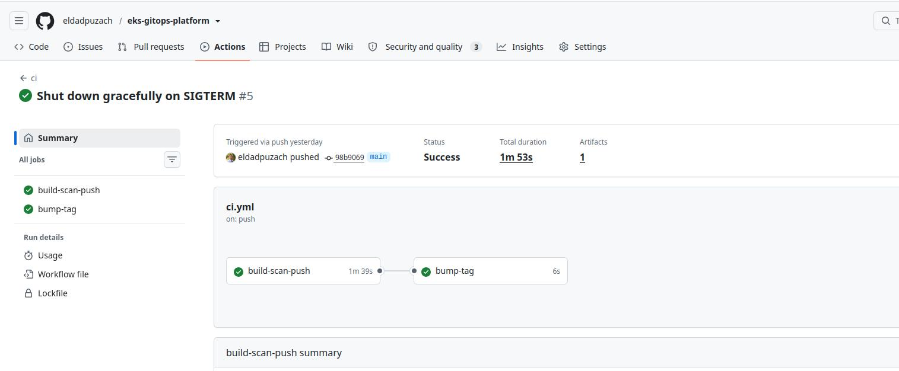
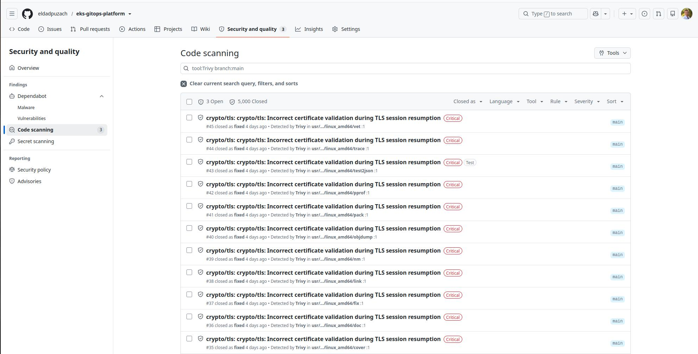

# eks-gitops-platform

A small but complete GitOps platform on Amazon EKS, built to production habits:

- **Terragrunt** wraps community Terraform modules for the VPC, EKS, ECR and GitHub OIDC.
- **GitHub Actions** builds the app image, gates it with **Trivy**, and pushes it to **ECR** using OIDC. No static AWS keys exist anywhere.
- **ArgoCD** watches this repo and syncs the app to the cluster. CI never touches the cluster.



## How a change reaches the cluster



1. A push to `main` that touches `app/` starts [`ci.yml`](.github/workflows/ci.yml).
2. The image is built and scanned. The full Trivy report goes to the **Security tab**, and the job **fails on HIGH/CRITICAL findings that have a fix**.
3. Only on `main`, the job assumes an IAM role through **GitHub OIDC** and pushes the image to ECR, tagged with the commit SHA (tags are immutable).
4. A second job writes the new tag into [`k8s/app/values.yaml`](k8s/app/values.yaml) and commits it as `github-actions[bot]`.
5. **ArgoCD pulls** that commit and rolls out the new pods. If anyone changes the cluster by hand, ArgoCD **self-heals** it back to what git says.



## Security choices

| Area | What I did | Why |
|---|---|---|
| AWS access from CI | GitHub **OIDC → IAM role**, trust scoped to this repo's **immutable IDs** and the `main` branch only | No long-lived keys to leak; a fork, a PR or a re-created repo with the same name gets `AccessDenied` |
| Least privilege | The CI role can push to **one ECR repo**; it has **no EKS access** at all | With GitOps, CI does not need cluster credentials |
| Image | Multi-stage build; runtime is **distroless static**, non-root (UID 65532), static Go binary | The first version (full `golang` image) had **950 OS CVEs**; the final image is 3 MB with **0 HIGH/CRITICAL** |
| Scan gate | Trivy fails on **HIGH/CRITICAL with a fix**; everything else is reported, not blocking | A CVE with no fix available should not block every release; it is tracked in the Security tab instead |
| Supply chain | Actions pinned by **full commit SHA**; Trivy installed as a release binary with **checksum check**; base images pinned by **digest** | Tags can be moved (as happened to `trivy-action` in 2026); SHAs and digests cannot |
| Pod | `runAsNonRoot`, read-only root filesystem, all capabilities dropped, `seccomp: RuntimeDefault`, no privilege escalation | Limits the damage of a compromised container |
| Graceful shutdown | The app handles **SIGTERM** and drains in-flight requests | No cut-off requests on deploy or scale-down (pods end `Completed`, not `Error`) |
| EKS API | Public endpoint limited to a small allow-list of admin IPs | `kubectl` from known networks only |
| Private values | Account ID and admin IPs live in gitignored files (`account.hcl`, a local ArgoCD Application); CI reads the role ARN from a repo variable | Nothing account-specific in this public repo |



## Repo layout

| Path | What |
|---|---|
| [`app/`](app/) | Go web app (`/`, `/healthz`) and Dockerfile |
| [`infra/live/root.hcl`](infra/live/root.hcl) | Remote state (S3 with native locking), generated provider with default tags and an account guard, pinned versions |
| [`infra/live/dev/`](infra/live/dev/) | One folder per unit: `vpc`, `eks`, `ecr`, `github-oidc`, `github-ci-role` |
| [`k8s/app/`](k8s/app/) | Helm chart for the app, synced by ArgoCD |
| [`k8s/argocd/`](k8s/argocd/) | ArgoCD Helm values and an example `Application` |
| [`.github/workflows/ci.yml`](.github/workflows/ci.yml) | Build, scan, push, bump tag |

Terragrunt works out the order from `dependency` blocks: `eks → vpc`, `github-ci-role → ecr, github-oidc`.

## How to run it

Requirements: Terraform ≥ 1.10, Terragrunt 1.x, AWS CLI, kubectl, Helm, `gh`.

```bash
# 1. Infrastructure
cp infra/live/account.hcl.example infra/live/account.hcl   # account ID + admin IPs
export AWS_PROFILE=<your-profile>
cd infra/live/dev
terragrunt backend bootstrap --all     # S3 state bucket, once
terragrunt run --all plan
terragrunt run --all apply             # ~15 min, mostly EKS

# 2. CI: point GitHub at the role; update the OIDC subject in github-ci-role for your repo
gh variable set AWS_ROLE_ARN --body "arn:aws:iam::<account>:role/eks-gitops-platform-dev-github-ci"

# 3. ArgoCD
aws eks update-kubeconfig --name eks-gitops-platform-dev --alias eks-gitops-dev
helm repo add argo https://argoproj.github.io/argo-helm
helm install argocd argo/argo-cd --version 10.10.5 -n argocd --create-namespace \
  -f k8s/argocd/values.yaml --wait

# 4. Register the app (copy the example and set your ECR registry)
cp k8s/argocd/app-dev.example.yaml k8s/argocd/app-dev.local.yaml
kubectl apply -f k8s/argocd/app-dev.local.yaml
```

Teardown: delete the ArgoCD `Application` first (its finalizer removes the app's resources), then `terragrunt run --all destroy`, then delete the state bucket by hand (Terragrunt created it, so it is not in any state).

## Design decisions

- **Terragrunt units, not one big root module.** Each unit has its own state and lock, so a bad EKS change cannot damage the VPC state, and a plan only refreshes what it needs. One `remote_state` block in `root.hcl` gives every unit its own key from its folder path.
- **S3 native locking** (`use_lockfile`) instead of a DynamoDB table: one resource less, and the DynamoDB method is deprecated.
- **`allowed_account_ids` in the generated provider** stops any run if the shell points at the wrong AWS account.
- **Helm chart, not Kustomize, for the app.** The registry (with the account ID) is set in the ArgoCD Application, while CI bumps only the tag in git. I tested ArgoCD's Kustomize image override first: it replaces the whole image entry and **drops the tag from git**. Helm merges values, so each part keeps its own source.
- **ArgoCD installed once with Helm; everything after that comes from git.** Installing it with Terraform's Helm provider was the other option, but it makes Terraform and ArgoCD both own cluster resources.
- **Spot nodes and one NAT gateway** to keep cost down (see below). A spot node was reclaimed during the week and the node group replaced it without any action.

## Problems I hit and how I solved them

- **`AccessDenied` on `AssumeRoleWithWebIdentity`.** STS does not say which condition failed. The failed event in **CloudTrail** shows the token's claims: GitHub now sends `sub` with immutable IDs (`repo:owner@id/repo@id:ref:...`), so the name-based condition never matched. I changed the trust policy to the ID-based subject.
- **Terraform: "text file busy"** when `run --all` initialised two new units in parallel with a shared plugin cache. Initialising them once and committing the `.terraform.lock.hcl` files fixed it, and it keeps every run on the same provider build.
- **Module inputs that depend on each other.** The ECR module needs both `create_repository_policy = false` and `attach_repository_policy = false`; reading the module's `main.tf` showed why.
- **Pods ending in `Error` on scale-down.** The app did not handle SIGTERM, so it died with exit code 143. Adding graceful shutdown fixed it.

## Cost

About **$5 per day** while running in eu-west-1: EKS control plane ~$2.40, NAT gateway ~$1.10, two spot `t3.medium`/`t3a.medium` nodes ~$0.70, plus public IPs, EBS and logs. ECR, IAM and the S3 state bucket cost almost nothing. Everything is code, so the stack is torn down when not in use and rebuilt in about 20 minutes.

## What I would do in production

- **Private EKS endpoint**, reached through VPN or SSM; SSO roles mapped with EKS access entries; read-only by default and a logged break-glass admin role.
- **ArgoCD with SSO** (OIDC) and RBAC, behind an internal ingress; delete the initial admin secret; **App of Apps / ApplicationSets** to manage many services and clusters from one place, including ArgoCD itself.
- **Promotion between environments** (dev → staging → prod) through pull requests, with a GitHub Environment and required reviewers for prod.
- **Image signing** with cosign (keyless, using the same GitHub OIDC identity) and signature verification in the cluster with an admission policy (Kyverno or Sigstore policy-controller).
- **Renovate** to bump action SHAs, Helm charts, provider versions and base-image digests automatically, so "zero CVE" stays true without manual work.
- **Secrets** from AWS Secrets Manager through External Secrets Operator and **EKS Pod Identity**, so pods get least-privilege AWS access without keys.
- **Karpenter** for node autoscaling with mixed spot and on-demand capacity, **HPA** and **PodDisruptionBudgets** for the app, and a `preStop` delay so load balancers stop routing before a pod shuts down.
- **Observability:** kube-prometheus-stack (or a managed service) with alerts on ArgoCD sync failures and pod restarts; centralised logs.
- **Multi-region:** add a region level in the Terragrunt tree (`live/<account>/<region>/<env>/<unit>`) and reuse the same units; route users with Route 53 or Global Accelerator.
- **`terragrunt plan` on pull requests**, posted as a PR comment, and applies only from CI with approval.

## How I used Claude Code

I built this with Claude Code as a pair programmer in my terminal. It looked up current tool, module and action versions and image digests, wrote first drafts of the Terragrunt units, workflow and chart, and explained trade-offs as we went. I reviewed every plan before any apply, ran the cluster checks myself, and used the tool to dig into failures (for example, reading CloudTrail to debug the OIDC trust policy, and testing the Kustomize override before relying on it). The rule was simple: nothing was applied, pushed or trusted without a plan, a scan or a test first.
